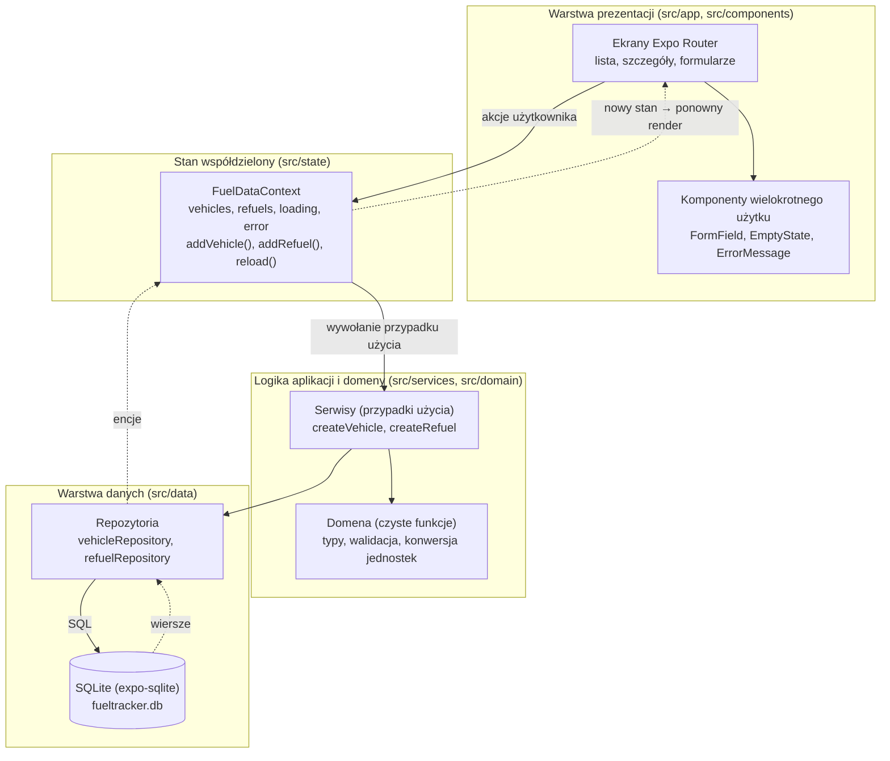
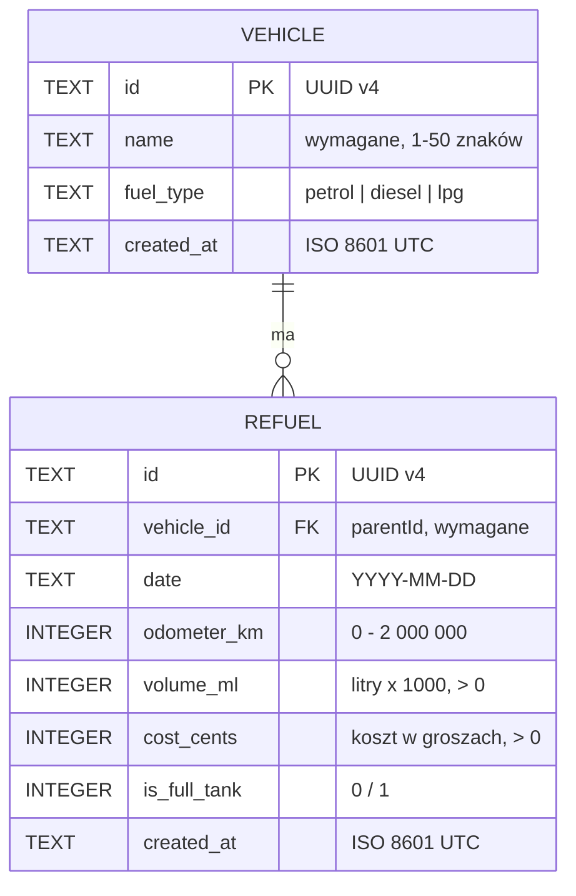
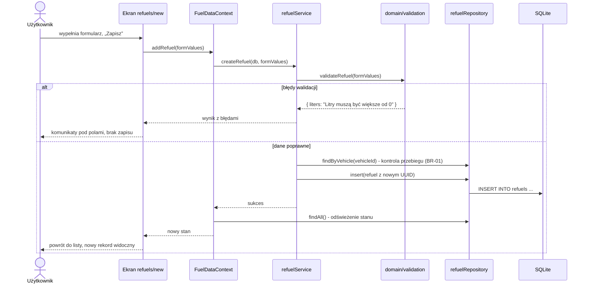
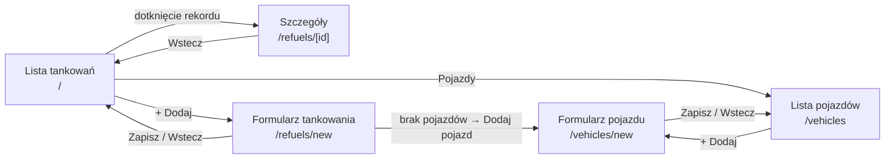

# Architektura aplikacji FuelTracker

**Projekt:** MOB-025 FuelTracker  
**Technologia:** React Native + Expo (SDK 58) + TypeScript

## 1. Przegląd

Aplikacja ma trzy warstwy z jednym kierunkiem zależności: **prezentacja → logika aplikacji → dostęp do danych**. Ekrany nie znają SQL-a, a logika domenowa nie zna komponentów UI. Dzięki temu reguły biznesowe (walidacja, spalanie) można testować bez uruchamiania aplikacji, a źródło danych można wymienić bez zmian w ekranach.



Strzałki ciągłe pokazują wywołania, przerywane - powrót danych do widoku.

## 2. Struktura katalogów

```text
FuelTracker/
├── app.json                 # konfiguracja Expo (pluginy: expo-router, expo-sqlite)
├── package.json             # main: expo-router/entry
└── src/
    ├── app/                 # ekrany (routing plikowy Expo Router)
    │   ├── _layout.tsx      # Stack + SQLiteProvider + FuelDataProvider
    │   ├── index.tsx        # lista tankowań
    │   ├── refuels/
    │   │   ├── new.tsx      # formularz dodawania tankowania
    │   │   └── [id].tsx     # szczegóły tankowania
    │   └── vehicles/
    │       ├── index.tsx    # lista pojazdów
    │       └── new.tsx      # formularz dodawania pojazdu
    ├── components/          # komponenty UI wielokrotnego użytku
    ├── state/               # FuelDataContext (stan współdzielony)
    ├── services/            # przypadki użycia: walidacja + zapis
    ├── domain/              # typy, walidacja, jednostki (bez React i SQLite)
    └── data/                # schemat bazy, migracje, repozytoria
```

| Warstwa | Odpowiedzialność | Przykład |
|---|---|---|
| `app/`, `components/` | Wyświetlanie danych, stan pól formularza, nawigacja, komunikaty | Ekran formularza pokazuje błąd pod polem „Litry” |
| `state/` | Jedno źródło prawdy o danych dla wszystkich ekranów | Po dodaniu tankowania lista odświeża się automatycznie |
| `services/` | Połączenie walidacji z zapisem (przypadek użycia) | `createRefuel` sprawdza przebieg względem innych tankowań pojazdu i zapisuje rekord |
| `domain/` | Reguły biznesowe jako czyste funkcje | `validateRefuel` blokuje litry ≤ 0 |
| `data/` | SQL, mapowanie wierszy na encje, migracje | `refuelRepository.insert()` |

## 3. Model danych



| Encja | Pole (TS / SQLite) | Typ | Wymagane | Znaczenie |
|---|---|---|---|---|
| Pojazd | `id` / `id` | UUID (TEXT) | Tak | Identyfikator lokalny |
| Pojazd | `name` / `name` | string (TEXT) | Tak | Nazwa pojazdu, np. „Skoda Octavia” |
| Pojazd | `fuelType` / `fuel_type` | enum (TEXT + CHECK) | Tak | Rodzaj paliwa: benzyna, diesel, LPG |
| Tankowanie | `id` / `id` | UUID (TEXT) | Tak | Identyfikator lokalny |
| Tankowanie | `vehicleId` / `vehicle_id` | UUID (TEXT, FK) | Tak | `parentId` z karty - powiązany pojazd |
| Tankowanie | `date` / `date` | data `YYYY-MM-DD` (TEXT) | Tak | Dzień tankowania |
| Tankowanie | `odometerKm` / `odometer_km` | int (INTEGER) | Tak | Stan licznika w km |
| Tankowanie | `volumeMl` / `volume_ml` | int (INTEGER) | Tak | Litry jako mililitry (45,32 l = 45320) |
| Tankowanie | `costCents` / `cost_cents` | int (INTEGER) | Tak | Koszt w groszach (289,99 zł = 28999) |
| Tankowanie | `isFullTank` / `is_full_tank` | boolean (INTEGER 0/1) | Tak | Czy tankowanie do pełna |

### Decyzje dotyczące typów

- **Kwoty i litry jako liczby całkowite** (grosze, mililitry). Karta wymaga wartości dziesiętnych, a nie binarnych float - `0.1 + 0.2 !== 0.3` w JavaScripcie. Tekst z formularza (np. „45,32”) jest parsowany bez użycia float bezpośrednio na liczbę całkowitą, a do wyświetlania formatowany z powrotem z przecinkiem.
- **Data tankowania jako `YYYY-MM-DD`** (data kalendarzowa bez godziny i strefy czasowej) - tankowanie z 31 grudnia zawsze pozostaje 31 grudnia, niezależnie od strefy urządzenia. Sortowanie tekstowe takiej daty jest jednocześnie chronologiczne. Pole techniczne `created_at` zapisywane jest w UTC (ISO 8601).
- **UUID v4** generowany lokalnie (`expo-crypto`), bez zależności od autoinkrementacji bazy.

### Relacja i integralność

- Relacja `Pojazd (1) → (N) Tankowanie` przez `refuels.vehicle_id REFERENCES vehicles(id) ON DELETE RESTRICT`, z włączonym `PRAGMA foreign_keys = ON`.
- **Tworzenie tankowania:** serwis sprawdza, czy pojazd istnieje (BR-04), a baza dodatkowo odrzuca nieistniejący klucz obcy.
- **Usuwanie pojazdu (Lab 3):** blokowane, jeśli pojazd ma tankowania - serwis zlicza powiązane rekordy i zwraca czytelny komunikat, a `ON DELETE RESTRICT` jest drugą linią obrony. Nie powstają osierocone rekordy.
- Ograniczenia `CHECK` w schemacie (`volume_ml > 0`, `cost_cents > 0`, `fuel_type IN (...)`) chronią dane nawet przy błędzie w warstwie logiki.

### Migracje

Schemat tworzy funkcja `migrateDb` wywoływana przez `SQLiteProvider` przy starcie. Wersja schematu jest zapisana w `PRAGMA user_version`, więc kolejne zmiany struktury można dodawać jako następne kroki migracji bez utraty danych.

## 4. Reguły biznesowe i walidacja

| ID | Reguła | Gdzie |
|---|---|---|
| BR-01 | Litry i koszt > 0; przebieg nie może maleć względem wcześniejszych tankowań pojazdu i nie może przekraczać późniejszych | `domain/validation.ts`, `services/refuelService.ts` (porównanie z innymi tankowaniami) |
| BR-02 | Spalanie l/100 km między kolejnymi tankowaniami do pełna, z uwzględnieniem tankowań częściowych pomiędzy | `domain/consumption.ts` (Lab 3) |
| BR-03 | Nazwa pojazdu niepusta; liczby i daty zgodne z typem i zakresem (data poprawna i nie z przyszłości, licznik 0-2 000 000 km, maks. 2 miejsca po przecinku dla kwoty i 3 dla litrów) | `domain/validation.ts` |
| BR-04 | Tankowanie wymaga istniejącego pojazdu; usunięcie pojazdu z tankowaniami blokowane | `services/`, klucz obcy w SQLite |

Walidacja zwraca obiekt `{ pole: komunikat }`, który formularz wyświetla pod odpowiednimi polami. Błędne dane nigdy nie trafiają do repozytorium.

## 5. Zarządzanie stanem i przepływ danych

- **Stan lokalny formularza** (`useState` w ekranie): wpisywany tekst, błędy walidacji, flaga „zapisywanie”. Istnieje tylko, dopóki ekran jest otwarty.
- **Stan współdzielony** (`FuelDataContext`): lista pojazdów i tankowań wczytana z bazy, flaga ładowania, błąd odczytu. Wszystkie ekrany czytają dane z jednego miejsca, więc nie ma rozbieżności między listą a szczegółami.
- **Źródło prawdy:** baza SQLite. Po każdym zapisie kontekst ponownie wczytuje dane z bazy, a React renderuje ekrany z nowym stanem.

Wybór: **React Context + hooki** zamiast Redux/Zustand - aplikacja ma dwie encje i kilka ekranów, więc dodatkowa biblioteka nie jest uzasadniona.

### Przepływ po naciśnięciu „Zapisz” (dodanie tankowania)



## 6. Nawigacja

Expo Router (routing plikowy, nawigacja stosu). Ekran startowy to lista tankowań.



## 7. Obsługa błędów i stanów UI

| Sytuacja | Zachowanie |
|---|---|
| Brak rekordów | Komunikat pustej listy z przyciskiem dodania pierwszego rekordu |
| Brak pojazdów przy dodawaniu tankowania | Informacja i przycisk „Dodaj pojazd” zamiast formularza |
| Błędy walidacji | Komunikat pod każdym błędnym polem, zapis zablokowany |
| Błąd zapisu w bazie | Komunikat „Nie udało się zapisać…”, dane w formularzu pozostają do ponownej próby |
| Błąd odczytu przy starcie | Komunikat z przyciskiem „Spróbuj ponownie” |
| Rekord nie istnieje (np. zły `id`) | Ekran szczegółów pokazuje „Nie znaleziono tankowania” |

## 8. Biblioteki

| Biblioteka | Cel | Uzasadnienie |
|---|---|---|
| `expo-router` | Nawigacja | Oficjalny router Expo, routing plikowy, nawigacja stosu oparta na React Navigation |
| `expo-sqlite` | Trwały zapis | Relacyjna baza z kluczami obcymi i ograniczeniami - naturalna dla relacji 1:N i blokady usuwania; działa w Expo Go |
| `expo-crypto` | UUID | `randomUUID()` bez dodatkowych zależności |
| `react-native-screens`, `react-native-safe-area-context`, `expo-linking`, `expo-constants` | Wymagane przez `expo-router` | Zależności równorzędne (peer dependencies) |
| `react-dom` | Wymagana przez webowe zależności `expo-router` | Przypięta do wersji `react` (19.3.0), aby rozwiązać konflikt wersji przy instalacji |

## 9. Ograniczenia

- Data wpisywana jest jako tekst `RRRR-MM-DD` (z domyślną dzisiejszą datą) zamiast natywnego kalendarza - mniej wygodne, ale bez dodatkowej biblioteki.
- Kontekst wczytuje wszystkie rekordy do pamięci; przy setkach tankowań jest to wystarczające, przy tysiącach należałoby stronicować zapytania.
- Przy kilku tankowaniach tego samego dnia kolejność ustalana jest według daty i przebiegu, bez godziny.
